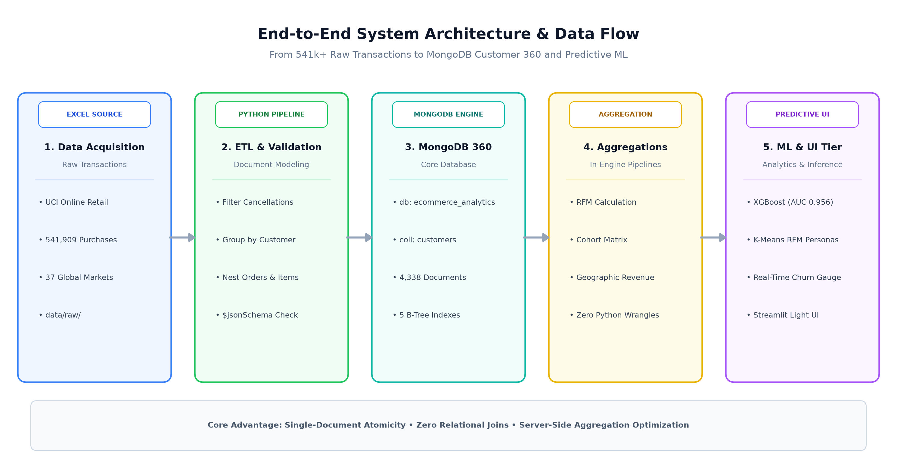
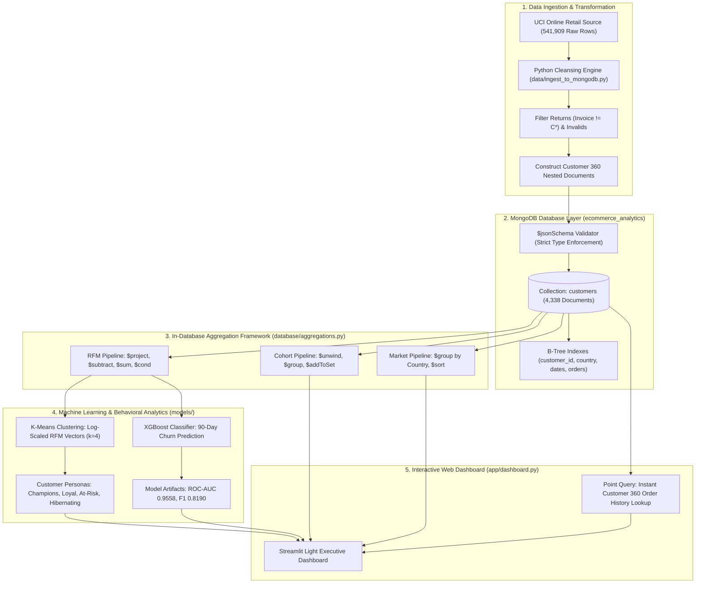
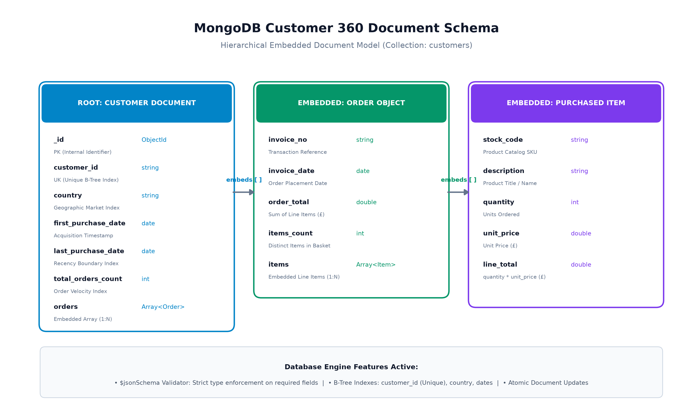
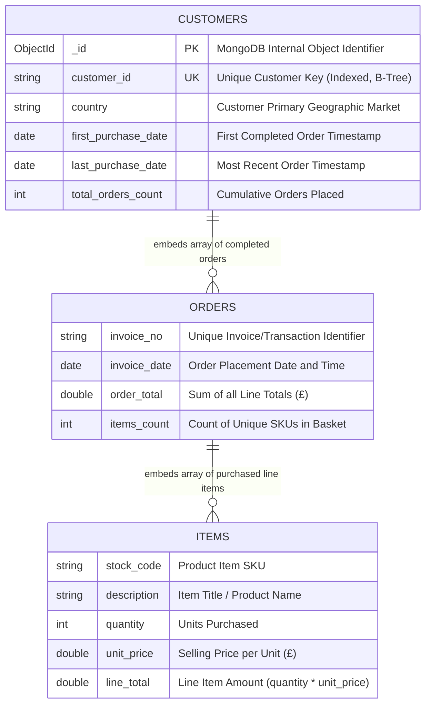

# E-Commerce_Customer_Analytics

## 🍃 MongoDB E-Commerce Customer 360° & Behavioral Analytics Engine

A production-grade **MongoDB Database & Data Engineering** platform that demonstrates how to architect a **Customer 360 Document Store**, enforce database governance with **`$jsonSchema`**, execute complex in-database **Aggregation Pipelines**, and power machine learning analytics on 541,000+ real-world retail transactions.

---

## 📌 Project Overview

Traditional relational databases (RDBMS) require costly multi-table `JOIN` operations across `Customers`, `Orders`, `Order_Items`, and `Products` to analyze customer purchasing behavior. 

This project re-engineers e-commerce data into an idiomatic **MongoDB Document Model**:
* **1 Customer = 1 Document** with embedded arrays of completed `orders` and line `items`.
* **Zero Relational Joins:** Eliminates cross-table overhead for instantaneous customer history lookups.
* **In-Database Feature Engineering:** MongoDB's C++ aggregation engine calculates **RFM metrics** (Recency, Frequency, Monetary), **Cohort Retention**, and **Churn Labels** directly inside the database.
* **Database-Driven ML:** Powers an unsupervised **K-Means RFM Persona model** and an **XGBoost Churn Classifier** (`ROC-AUC: 0.9558`).

---

## 🔄 End-to-End System Architecture & Data Flow

<p align="center">
  
</p>

<details>
<summary><b>View Mermaid Source Code</b></summary>


</details>

---

## 🗄️ Database Schema & Entity-Relationship Model

### Document-Oriented Entity-Relationship Diagram (ERD)

In MongoDB, relationships between Customers, Orders, and Purchased Items are modeled through **embedding (document nesting)** rather than normalization. One root document holds the customer's entire lifetime history:

<p align="center">
  
</p>

<details>
<summary><b>View Mermaid Schema ERD</b></summary>


</details>

### Relational (RDBMS) vs MongoDB Document Model Comparison

| Aspect | Traditional Relational RDBMS | MongoDB Customer 360 Architecture |
| :--- | :--- | :--- |
| **Physical Storage** | 4 separate normalized tables (`Customers`, `Invoices`, `Invoice_Items`, `Products`) | 1 unified, self-contained document per customer |
| **Query Complexity** | Requires multiple `INNER/LEFT JOIN` operations across millions of rows | Direct point read `db.customers.findOne({ customer_id: "17850" })` in `O(1)` |
| **ACID Scope** | Multi-table transactions with locking overhead | **Single-Document Atomicity** — updates to orders & items succeed or fail atomically |
| **Schema Governance** | Rigid DDL schema migrations | Dynamic schema enforced via **`$jsonSchema`** with flexible field nesting |
| **Performance** | Degradation as foreign-key index trees grow large | Embedded arrays deliver zero-join caching locality |

---

### Concrete Customer 360 JSON Document
```json
{
  "_id": ObjectId("67207c4b1234567890abcdef"),
  "customer_id": "17850",
  "country": "United Kingdom",
  "first_purchase_date": ISODate("2010-12-01T08:26:00.000Z"),
  "last_purchase_date": ISODate("2011-02-10T14:38:00.000Z"),
  "total_orders_count": 34,
  "orders": [
    {
      "invoice_no": "536365",
      "invoice_date": ISODate("2010-12-01T08:26:00.000Z"),
      "order_total": 139.12,
      "items_count": 7,
      "items": [
        {
          "stock_code": "85123A",
          "description": "WHITE HANGING HEART T-LIGHT HOLDER",
          "quantity": 6,
          "unit_price": 2.55,
          "line_total": 15.30
        },
        {
          "stock_code": "71053",
          "description": "WHITE METAL LANTERN",
          "quantity": 6,
          "unit_price": 3.39,
          "line_total": 20.34
        }
      ]
    }
  ]
}
```

---

## 🛡️ Database Governance: `$jsonSchema` Validation

To guarantee strict clinical/financial data integrity without sacrificing document flexibility, collection-level validation is enforced via MongoDB's **`$jsonSchema` validator** ([`config/schema_validation.json`](file:///d:/MongoDB/config/schema_validation.json)):

```javascript
db.createCollection("customers", {
  validator: {
    $jsonSchema: {
      bsonType: "object",
      required: ["customer_id", "country", "orders"],
      properties: {
        customer_id: { bsonType: "string" },
        country: { bsonType: "string" },
        first_purchase_date: { bsonType: "date" },
        last_purchase_date: { bsonType: "date" },
        total_orders_count: { bsonType: ["int", "long"] },
        orders: {
          bsonType: "array",
          items: {
            bsonType: "object",
            required: ["invoice_no", "invoice_date", "items"],
            properties: {
              invoice_no: { bsonType: "string" },
              invoice_date: { bsonType: "date" },
              order_total: { bsonType: ["double", "int", "long"] },
              items_count: { bsonType: ["int", "long"] }
            }
          }
        }
      }
    }
  },
  validationLevel: "strict",
  validationAction: "error"
});
```

---

## ⚡ Indexing Strategy & Performance Optimization

To support high-throughput read/write workloads and fast aggregation queries, the collection utilizes optimized single and compound indexes:

| Index Name | Key | Type | Use Case / Query Pattern |
| :--- | :--- | :--- | :--- |
| `customer_id_1` | `{ customer_id: 1 }` | **Unique B-Tree** | Point lookups (`O(1)`), prevents duplicate customer profiles |
| `country_1` | `{ country: 1 }` | **B-Tree** | Geographic market segment filtering and aggregation |
| `last_purchase_date_1` | `{ last_purchase_date: 1 }` | **B-Tree** | Recency calculations, churn boundary date queries |
| `first_purchase_date_1` | `{ first_purchase_date: 1 }` | **B-Tree** | Cohort acquisition window grouping |
| `total_orders_count_1` | `{ total_orders_count: 1 }` | **B-Tree** | High-value VIP customer filtering (`$gt`) |

> **Explain Plan Verification:** Running `.explain("executionStats")` on customer lookups confirms index scans (`IXSCAN`) with zero full collection scans (`COLLSCAN`).

---

## 🔬 In-Database MongoDB Aggregation Framework

All core business logic and feature engineering are executed directly in MongoDB:

### 1. In-Database RFM & Churn Aggregation Pipeline
Extracts recency, frequency, monetary lifetime value (CLV), average basket size, and 90-day churn labels using mathematical operators and array reductions:

```javascript
db.customers.aggregate([
  {
    $project: {
      customer_id: 1,
      country: 1,
      frequency: { $size: { $ifNull: ["$orders", []] } },
      monetary: { $round: [{ $sum: "$orders.order_total" }, 2] },
      total_items: { $sum: "$orders.items_count" },
      recency_days: {
        $round: [
          {
            $divide: [
              { $subtract: [ISODate("2011-12-10T00:00:00Z"), "$last_purchase_date"] },
              1000 * 60 * 60 * 24
            ]
          },
          1
        ]
      },
      tenure_days: {
        $round: [
          {
            $divide: [
              { $subtract: [ISODate("2011-12-10T00:00:00Z"), "$first_purchase_date"] },
              1000 * 60 * 60 * 24
            ]
          },
          1
        ]
      }
    }
  },
  {
    $project: {
      customer_id: 1,
      country: 1,
      recency_days: 1,
      frequency: 1,
      monetary: 1,
      avg_order_value: {
        $round: [
          { $cond: [{ $gt: ["$frequency", 0] }, { $divide: ["$monetary", "$frequency"] }, 0] },
          2
        ]
      },
      is_churned: {
        $cond: [{ $gte: ["$recency_days", 90] }, 1, 0]
      }
    }
  }
])
```

### 2. Monthly Triangular Cohort Retention Pipeline
Unwinds customer orders, computes month offsets relative to first acquisition, and calculates retention decay using `$addToSet`:

```javascript
db.customers.aggregate([
  { $unwind: "$orders" },
  {
    $project: {
      customer_id: 1,
      cohort_month: { $dateToString: { format: "%Y-%m", date: "$first_purchase_date" } },
      order_month: { $dateToString: { format: "%Y-%m", date: "$orders.invoice_date" } },
      cohort_year: { $year: "$first_purchase_date" },
      cohort_mo: { $month: "$first_purchase_date" },
      order_year: { $year: "$orders.invoice_date" },
      order_mo: { $month: "$orders.invoice_date" }
    }
  },
  {
    $project: {
      customer_id: 1,
      cohort_month: 1,
      month_index: {
        $add: [
          { $multiply: [{ $subtract: ["$order_year", "$cohort_year"] }, 12] },
          { $subtract: ["$order_mo", "$cohort_mo"] }
        ]
      }
    }
  },
  {
    $group: {
      _id: { cohort_month: "$cohort_month", month_index: "$month_index" },
      active_customers: { $addToSet: "$customer_id" }
    }
  },
  {
    $project: {
      cohort_month: "$_id.cohort_month",
      month_index: "$_id.month_index",
      customer_count: { $size: "$active_customers" }
    }
  },
  { $sort: { cohort_month: 1, month_index: 1 } }
])
```

---

## 📁 Clean & Intuitive Project Structure

```
d:\MongoDB\
├── app/
│   └── dashboard.py              # Streamlit Web UI (Clean light theme)
├── config/
│   ├── settings.py               # Database URI, collection names, thresholds
│   └── schema_validation.json    # Strict MongoDB $jsonSchema definitions
├── data/
│   ├── raw/
│   │   └── Online Retail.xlsx    # UCI Retail transaction source (541k records)
│   ├── download_dataset.py       # Automated dataset downloader
│   └── ingest_to_mongodb.py      # Cleans & constructs Customer 360 documents
├── database/
│   ├── mongo_client.py           # Thread-safe MongoDB connection pool
│   ├── validation_setup.py       # Applies $jsonSchema validators & indexes
│   └── aggregations.py           # In-database RFM, Cohort & Geo pipelines
├── models/
│   ├── rfm_segmentation.py       # K-Means clustering & Persona scoring
│   ├── churn_model.py            # XGBoost churn model
│   └── saved_models/             # Persisted models, scalers, and metrics
├── queries/
│   └── mongo_queries.js          # Standalone MongoDB shell scripts for mongosh
├── main.py                       # Master end-to-end orchestration runner
├── requirements.txt              # Python library dependencies
├── run_dashboard.bat             # 1-Click launcher for Windows
└── README.md                     # Comprehensive database documentation
```

---

## 🚀 How to Run the Project

### Prerequisites
* **MongoDB Community Server 6.0+** running locally on port `27017`
* **Python 3.10+**

### MongoDB Connection

The project connects to `mongodb://localhost:27017/` by default. To use MongoDB Atlas
or another server, set `MONGO_URI` in your environment; keep credentials out of source
files and do not commit them.

```powershell
$env:MONGO_URI = "mongodb+srv://<username>:<password>@<cluster-host>/"
```

### Step 1: 1-Click Launch (Easiest)
Simply double-click **`run_dashboard.bat`** in Windows Explorer. 

It will automatically:
1. Verify the virtual environment.
2. Connect to MongoDB.
3. Launch the dashboard at `http://localhost:8501`.

---

### Step 2: Running via Command Line

1. **Activate Virtual Environment:**
   ```powershell
   cd d:\MongoDB
   .\.venv\Scripts\Activate.ps1
   ```

2. **Execute Full Pipeline (Data Processing & Model Training):**
   ```powershell
   python main.py
   ```

3. **Start the Web Dashboard:**
   ```powershell
   streamlit run app/dashboard.py
   ```

---

### Step 3: Running Queries Directly in MongoDB Shell (`mongosh`)

You can run our portfolio of MongoDB queries directly using `mongosh`:

```powershell
mongosh < queries/mongo_queries.js
```

Or connect via **MongoDB Compass GUI** (`mongodb://localhost:27017`) and navigate to:
* **Database:** `ecommerce_analytics`
* **Collection:** `customers`

---

## 📊 Machine Learning Diagnostic Scorecard

* **Model:** XGBoost Classifier (with class balancing `scale_pos_weight=1.99`)
* **Features:** Frequency, Monetary (CLV), Tenure, AOV, Items/Basket, Country *(No recency leakage)*
* **ROC-AUC Score:** `0.9558`
* **Precision-Recall AUC:** `0.9292`
* **Accuracy:** `87.00%`
* **F1 Score:** `0.8190`
* **Silhouette Score (K-Means RFM):** `0.337` (4 clean clusters: Champions, Loyal, At-Risk, Hibernating)
